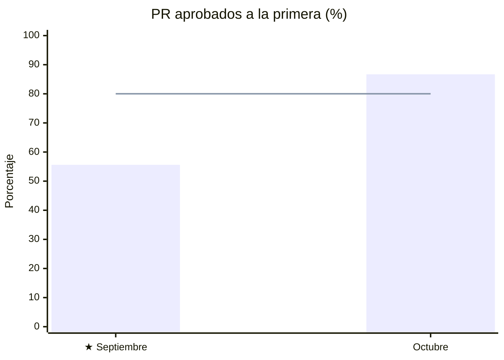
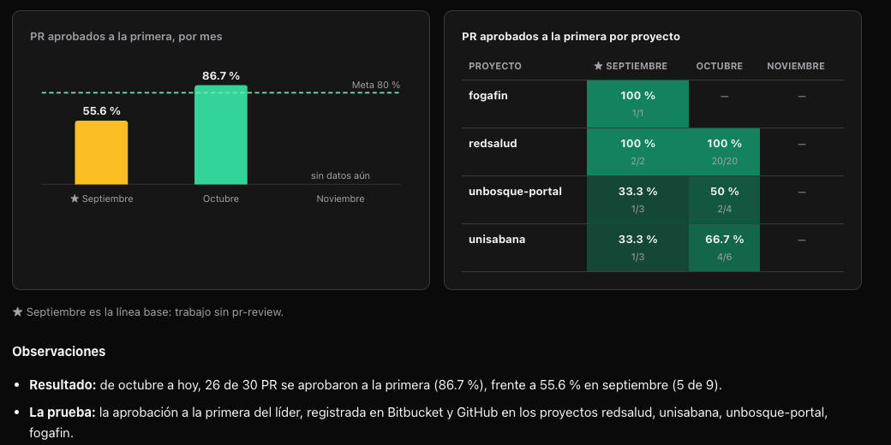
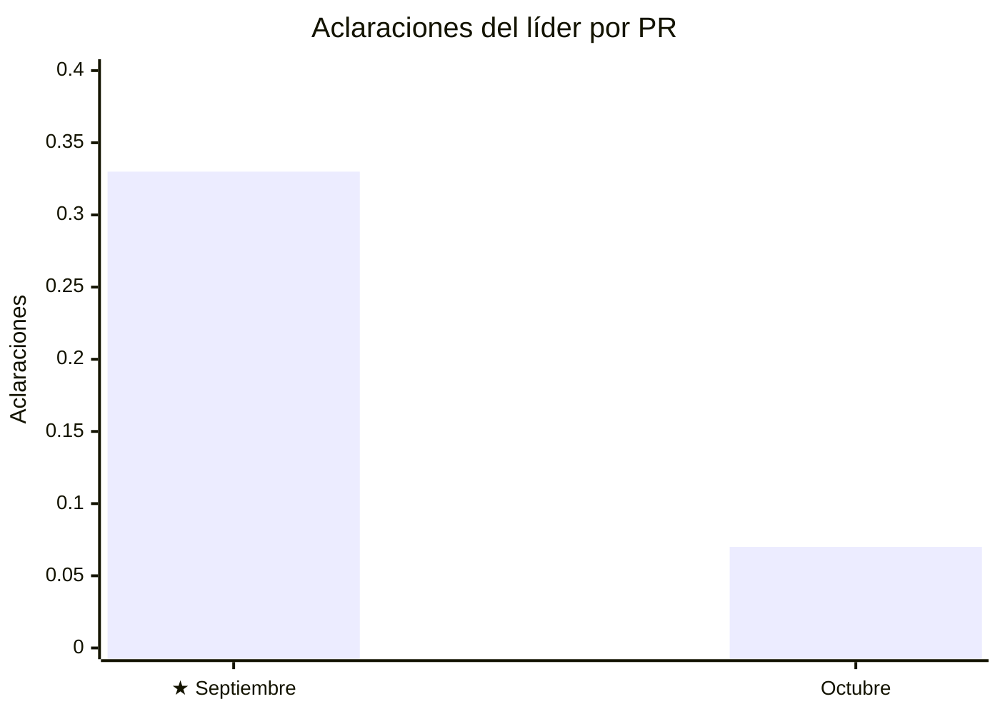
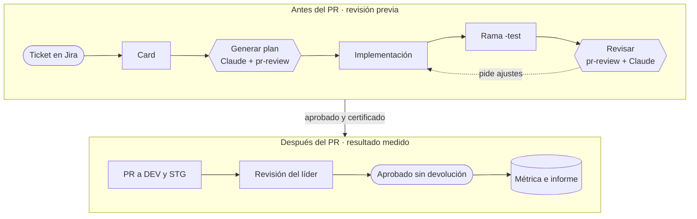
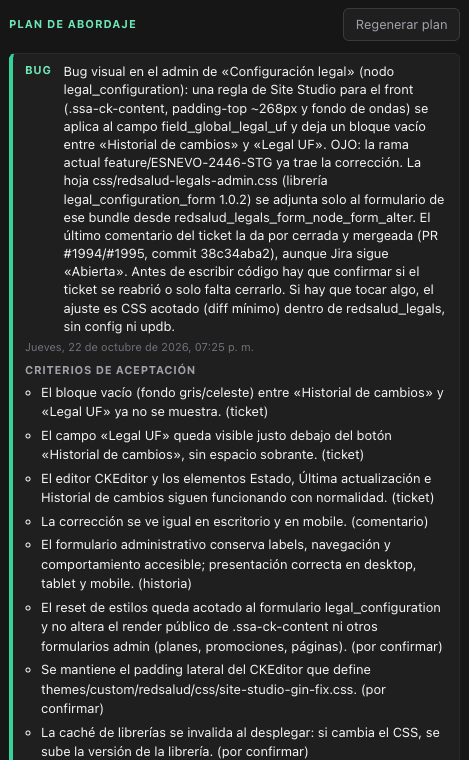
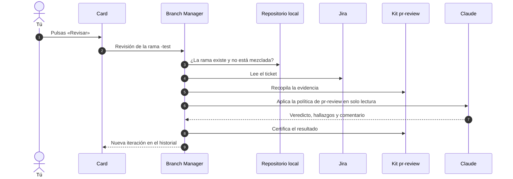
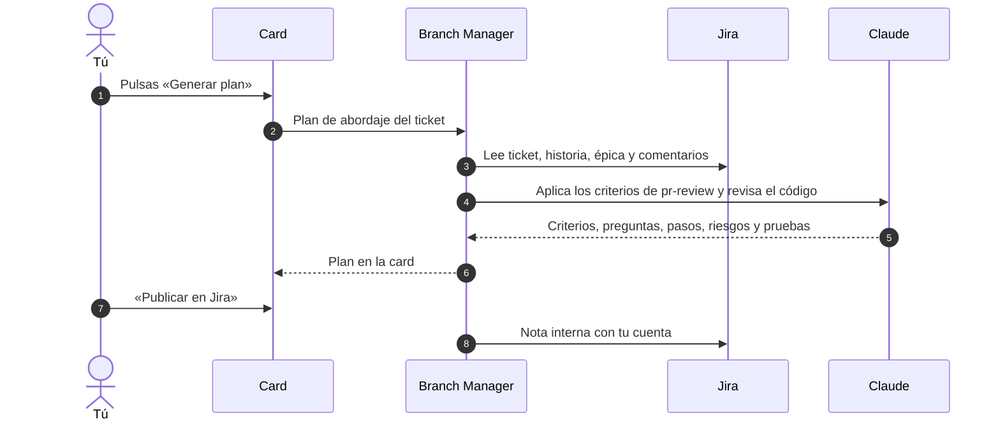
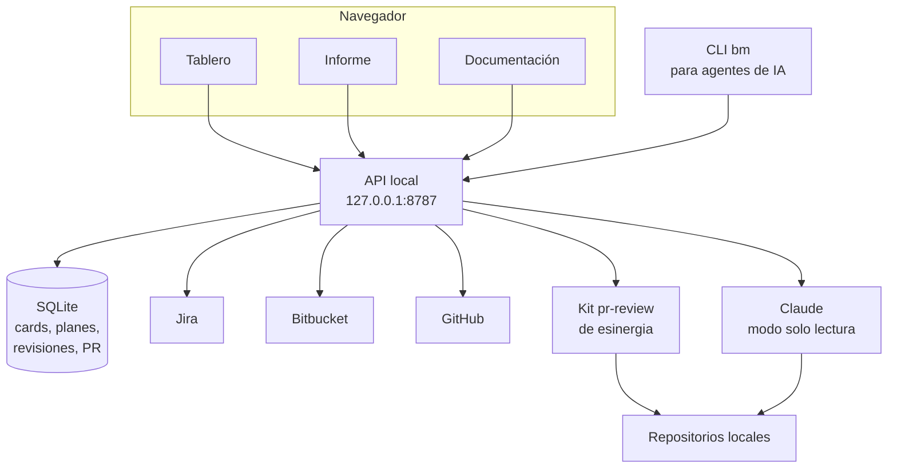

<div align="center">

# Branch Manager · Jira Smart Project

**Del ticket de Jira al PR aprobado a la primera, con revisión previa de IA.**

Planifica cada ticket con IA, revisa el PR con **pr-review de esinergia + Claude** antes de que llegue al líder
y mide cuántos PR se aprueban sin devolución en todos los proyectos.


<br/>


</div>

<br/>

> [!IMPORTANT]
> ## ✅ 2 de 3 objetivos cumplidos
>
> | | Objetivo | Resultado | Meta |
> |:-:|---|:-:|:-:|
> | ✅ | **Capa 2** · PR de Git aprobados sin retrabajo | **86,7 %** · 26 de 30 PR | ≥ 80 % |
> | ✅ | **Capa 3** · Revisión previa de PR con pr-review e IA | **−80 %** de aclaraciones del líder | ≥ −80 % |
> | ⏳ | **Capa 1** · Biblioteca de conocimiento de Site Studio | Se reporta aparte | 4/5 con ≥ 6 devs |
>
> Datos de Bitbucket y GitHub al 22 de octubre de 2026. El informe vivo está en **`/informe`** y se descarga en PDF o CSV.

<br/>

## Contenido

| | |
|---|---|
| **📊 Informe** | [Resultados](#-resultados) · [Capa 2](#capa-2--pr-de-git-aprobados-sin-retrabajo) · [Capa 3](#capa-3--revisión-previa-de-pr-con-pr-review-e-ia) · [Capa 1](#capa-1--biblioteca-de-site-studio) |
| **📘 Documentación** | [Flujo](#-flujo-de-trabajo) · [Anatomía de la card](#-anatomía-de-la-card) · [Agentes y servicios](#-agentes-y-servicios) · [Tablero](#-el-tablero) · [CLI para agentes](#-cli-para-agentes-de-ia) |
| **⚙️ Técnico** | [Arquitectura](#-arquitectura) · [Instalación](#-instalación) · [Estructura](#-estructura-del-proyecto) · [Seguridad](#-seguridad) |

<br/>

---

# 📊 Resultados

<br/>

## Capa 2 · PR de Git aprobados sin retrabajo

> Lograr que al menos el 80 % de los pull requests de Git entre octubre y el 30 de noviembre de 2026, realizados con apoyo de IA, se aprueben sin retrabajo, verificando antes de cada envío los criterios de aceptación del ticket y los estándares técnicos, definiendo y confirmando con el solicitante los criterios cuando el ticket no los trae, y comparándolo contra la línea base de septiembre registrada en Branch Manager.

<table>
<tr>
<td align="center" width="33%"><h1>86,7 %</h1>PR aprobados a la primera<br/><sub>octubre · 26 de 30</sub></td>
<td align="center" width="33%"><h1>▲ +31,1 pp</h1>frente a la línea base<br/><sub>★ septiembre · 55,6 %</sub></td>
<td align="center" width="33%"><h1>4</h1>proyectos medidos<br/><sub>redsalud · unisabana · unbosque · fogafin</sub></td>
</tr>
</table>



<sub>La línea marca la meta del 80 %. ★ Septiembre es la línea base, trabajo sin pr-review.</sub>

### Por proyecto

| Proyecto | ★ Septiembre | Octubre | Tendencia |
|---|:-:|:-:|:-:|
| **redsalud** · Bitbucket | 🟩 100 % · 2/2 | 🟩 **100 % · 20/20** | ➡️ |
| **unisabana** · GitHub | 🟥 33,3 % · 1/3 | 🟨 **66,7 % · 4/6** | ⬆️ |
| **unbosque-portal** · GitHub | 🟥 33,3 % · 1/3 | 🟨 **50 % · 2/4** | ⬆️ |
| **fogafin** · GitHub | 🟩 100 % · 1/1 | — | |
| **Total** | **55,6 % · 5/9** | **86,7 % · 26/30** | ⬆️ |

<p align="center"></p>

<details>
<summary><b>Observaciones</b></summary>
<br/>

- **La prueba:** la aprobación a la primera del líder, registrada en Bitbucket (redsalud) y GitHub (unisabana, unbosque-portal, fogafin).
- **Cómo se cuenta:** cada PR hacia `staging` o `develop`. Es retrabajo si el revisor lo devolvió: pidió cambios, dejó comentarios, tuvo que hacer commits en la rama o lo rechazó. No cuentan los PR que el propio autor cerró sin revisión.
- **Cómo se logró:** antes de cada envío se revisaron con pr-review y la IA los criterios de aceptación del ticket y los estándares técnicos de esinergia. Cuando el ticket no traía criterios, se definieron y confirmaron con el solicitante.
- **Las 4 devoluciones de octubre:** dos comentarios en unbosque-portal (#125 y #129) y dos ajustes que hizo el revisor en unisabana (#419 y #421).

</details>

<br/>

## Capa 3 · Revisión previa de PR con pr-review e IA

> Integrar en Branch Manager el código de pr-review de Esinergia y combinarlo con un modelo de IA (Gemini o Claude) antes del 30 de noviembre de 2026, para aplicar la revisión del PR antes de que llegue al líder: al iniciar cada ticket, leyéndolo desde Jira sin copiarlo a mano y dejando una nota sobre cómo abordarlo según sus criterios; y antes de solicitar el PR a staging, revisando la entrega y dejando las correcciones a aplicar o el visto bueno, en Branch Manager o como comentario en Jira si la API lo permite. Se demostrará con 3 entregas comparadas una reducción de al menos 80 % en las aclaraciones durante la revisión del líder.

<table>
<tr>
<td align="center" width="33%"><h1>−80 %</h1>aclaraciones del líder<br/><sub>por PR</sub></td>
<td align="center" width="33%"><h1>0,33 → 0,07</h1>aclaraciones por PR<br/><sub>★ septiembre → octubre</sub></td>
<td align="center" width="33%"><h1>3 → 0</h1>en las 3 entregas comparadas<br/><sub>−100 %</sub></td>
</tr>
</table>



### 3 entregas comparadas

<table>
<tr><th width="50%">★ Septiembre · sin pr-review</th><th width="50%">Octubre · con pr-review</th></tr>
<tr>
<td>

| PR | Ticket | Aclaraciones |
|---|---|:-:|
| unbosque-portal #110 | EVO-926 | 🟥 1 |
| unbosque-portal #120 | EVO-926 | 🟥 1 |
| unisabana #409 | ESNEVO-880 | 🟥 1 |

</td>
<td>

| PR | Ticket | Aclaraciones |
|---|---|:-:|
| redsalud #1994 | ESNEVO-2446 | 🟩 0 |
| redsalud #1992 | ESNEVO-2544 | 🟩 0 |
| redsalud #1981 | ESNEVO-2759 | 🟩 0 |

</td>
</tr>
</table>

### Uso de la IA

| Momento | Qué hace | Dónde |
|---|---|---|
| **Al iniciar el ticket** | Claude lee el ticket, su historia y sus comentarios desde Jira y deja el plan con los criterios de pr-review | Card → «Generar plan» → «Publicar en Jira» |
| **Antes del PR a staging** | El kit pr-review y Claude revisan la rama `-test`, dejan correcciones o visto bueno y certifican el resultado | Card → «Revisar» |
| **Después del PR** | Se mide si el líder lo aprobó a la primera | Card → Pull requests · Informe |

<br/>

## Capa 1 · Biblioteca de Site Studio

> Construir y publicar una biblioteca de conocimiento de Site Studio en video para el equipo Frontend que cubra los temas de dependencia confirmados con los seniors, y lograr una calificación promedio de al menos 4 sobre 5 por parte de mínimo 6 desarrolladores antes del 30 de noviembre de 2026.

⏳ Se gestiona y se reporta por fuera de Branch Manager.

<br/>

---

# 📘 Documentación

<br/>

## 🔁 Flujo de trabajo



<br/>

## 🧩 Anatomía de la card

<table>
<tr>
<td width="38%" valign="top"></td>
<td valign="top">

| # | Parte | Qué hace | Qué se dispara | Objetivo |
|:-:|---|---|---|:-:|
| 1 | **Encabezado** | Clave, título, fechas y estado en Jira (franja de color) | Jira | Base |
| 2 | **Comentario destacado** | Fija un comentario de Jira a la vista | Jira | Base |
| 3 | **Plan de abordaje** | Plan del ticket con criterios, preguntas, archivos, pasos, riesgos y pruebas | Jira · Claude · repo | Capa 3 · Capa 2 |
| 4 | **Ramas** | Trabajo, DEV y STG; con «Release», las ramas unidas | Base local | Base |
| 5 | **Pull requests** | Cada PR con «Aprobado sin devolución», «Devuelto» o «Abierto» | Bitbucket · GitHub | Capa 2 |
| 6 | **Revisión local** | «Revisar» simula el PR con pr-review + Claude y certifica | Repo · Jira · Kit · Claude | Capa 3 |
| 7 | **Despliegue** | Marca el ticket en producción o hace rollback | Base local | Base |

</td>
</tr>
</table>

<details>
<summary><b>Ver cada parte en detalle</b></summary>
<br/>

| Parte | Captura |
|---|---|
| **3 · Plan de abordaje** — se usa al iniciar el ticket. «Publicar en Jira» lo deja como nota interna. |  |
| **4 · Ramas** — los nombres que usa la revisión. |  |
| **5 · Pull requests** — la evidencia de la meta del 80 %. |  |
| **6 · Revisión local** — cada «Revisar» queda como iteración. |  |

</details>

<br/>

## 🤖 Agentes y servicios

| Agente o servicio | Qué hace | Se dispara con | Objetivo |
|---|---|---|:-:|
| **Claude · plan de abordaje** | Lee el ticket desde Jira y el código, y propone cómo abordarlo con los criterios de pr-review | «Generar plan» · `bm plan` | Capa 3 |
| **Kit pr-review de esinergia** | Reúne la evidencia de la rama `-test`: diferencias, flujo de ramas y bloqueos | «Revisar» · `bm review` | Capa 3 |
| **Claude · revisión de PR** | Aplica la política de pr-review en solo lectura: veredicto, hallazgos y comentario | «Revisar» · `bm review` | Capa 3 |
| **Certificación pr-review** | Firma el resultado con el commit exacto revisado | Automática | Capa 3 |
| **Bitbucket y GitHub** | Aprobaciones, cambios pedidos, comentarios y commits del revisor | Tablero · «Sincronizar PR» | Capa 2 |
| **Jira** | Tickets, comentarios y notas internas | Buscador · plan · destacados | Base |

<details>
<summary><b>Qué pasa al pulsar «Revisar»</b></summary>



</details>

<details>
<summary><b>Qué pasa al pulsar «Generar plan»</b></summary>



</details>

<br/>

## 🖥️ El tablero

<p align="center"></p>

| Zona | Para qué sirve |
|---|---|
| **Buscador** | Busca un ticket de Jira y crea su card |
| **Barra de la métrica** | ★ Septiembre contra octubre y noviembre, con la meta y las aclaraciones |
| **Pendientes · En producción** | Tus cards según su estado de despliegue |
| **Abiertos, en curso y bloqueados** | Tus tickets asignados en Jira, con el último comentario |
| **Informe · Documentación** | `/informe` (PDF y CSV) y `/documentacion` |

<br/>

## ⌨️ CLI para agentes de IA

Todo lo que hace la card también se hace desde la terminal, para que cualquier agente lo use.

| Comando | Qué hace | Objetivo |
|---|---|:-:|
| `bm plan CLAVE --wait` | Genera el plan de abordaje | Capa 3 |
| `bm plan-publish CLAVE` | Publica el plan en Jira (con permiso del usuario) | Capa 3 |
| `bm review CLAVE --wait` | Revisa la rama `-test` con pr-review | Capa 3 |
| `bm prs CLAVE --sync` | PR del ticket y su resultado | Capa 2 |
| `bm metrics --sync --detail` | Métrica de objetivos con el detalle de cada PR | Capa 2 |
| `bm card add CLAVE` | Crea la card de un ticket | Base |

<br/>

---

# ⚙️ Técnico

<br/>

## 🏗️ Arquitectura



| Capa | Tecnología |
|---|---|
| Interfaz | React 19 · TypeScript · Vite · SCSS (atomic design) · Mermaid · jsPDF |
| API local | Node.js 24 (`node:http`) · Drizzle ORM · SQLite (better-sqlite3) |
| IA | Claude Code en modo headless, restringido y de solo lectura |
| Revisión | Kit `ai-pr-review` de esinergia, usado de forma global |
| Integraciones | Jira REST · Bitbucket API · GitHub (`gh`) |

<br/>

## 🚀 Instalación

```bash
cd branch-client
npm install
npm run dev        # tablero en http://localhost:5173 y API en http://127.0.0.1:8787
```

Variables en el `.env` de la raíz (solo los nombres):

| Variable | Para qué |
|---|---|
| `JIRA_BASE_URL` · `JIRA_EMAIL` · `JIRA_API_TOKEN` | Leer tickets y publicar notas internas |
| `BRANCH_CLAUDE_CONFIG_DIR` | Cuenta de Claude que usan el plan y la revisión |
| `BITBUCKET_ENV_FILE` *(opcional)* | Archivo con las credenciales de Bitbucket |
| `PR_REVIEW_KIT_HOME` *(opcional)* | Ruta del kit pr-review (por defecto `../pr-review`) |

GitHub usa la sesión de `gh` ya iniciada en el equipo.

<br/>

## 📁 Estructura del proyecto

```
branch-client/
├── bin/bm.ts                  CLI para agentes de IA
├── server/                    API local
│   ├── providers/             Bitbucket y GitHub
│   ├── review-runner.ts       pr-review + Claude + certificación
│   ├── plan-runner.ts         Plan de abordaje
│   └── db/                    Esquema y migraciones SQLite
├── src/
│   ├── components/            Atomic design: átomos → páginas
│   │   └── 05-pages/          /informe y /documentacion
│   ├── content/diagrams.ts    Diagramas de la documentación
│   └── utils/deliveries.ts    Regla de «aprobado sin devolución»
└── public/docs/               Capturas para la documentación
```

<br/>

## 🔒 Seguridad

- Todo corre **en el equipo local**: la API escucha solo en `127.0.0.1` y rechaza peticiones de otros orígenes.
- La IA trabaja en **solo lectura**: sin escritura de archivos, sin comandos que modifiquen el repositorio y sin MCP.
- Las **credenciales** se filtran antes de lanzar procesos y nunca llegan a la IA ni al navegador.
- Las publicaciones en Jira son **notas internas** y siempre piden confirmación.

<br/>

<div align="center"><sub>esinergia S.A.S. · Johan Riascos · 2026</sub></div>
