<div align="center">


</div>

<table>
<tr>
<td width="58%" valign="top">

### 🧭 Qué es

Un tablero para llevar cada ticket de Jira hasta producción.
La IA **planifica** el ticket, **revisa el PR antes que el líder** y el tablero **mide** cuántos PR se aprueban a la primera.

<br/>

### ✅ 2 de 3 objetivos cumplidos

| | Objetivo | Resultado |
|:-:|---|:-:|
| ✅ | **Capa 2** · PR aprobados sin retrabajo | **86,7 %** <sub>meta 80 %</sub> |
| ✅ | **Capa 3** · Revisión previa con pr-review e IA | **−80 %** <sub>meta −80 %</sub> |
| ⏳ | **Capa 1** · Biblioteca de Site Studio | <sub>se reporta aparte</sub> |

<br/>

[](#-informe)
[](#-documentación)
[](#-técnico)

<br/>

### ⚡ Cómo funciona

| | Paso | |
|:-:|---|:-:|
| 🧠 | **Planifica** · Claude lee el ticket de Jira y deja el plan | `Capa 3` |
| 🔍 | **Revisa** · pr-review + Claude revisan la rama antes del PR | `Capa 3` |
| 📈 | **Mide** · cuántos PR aprueba el líder a la primera | `Capa 2` |

<sub>Datos de Bitbucket y GitHub al 22 de octubre de 2026.</sub>

</td>
<td width="42%" align="center" valign="top">

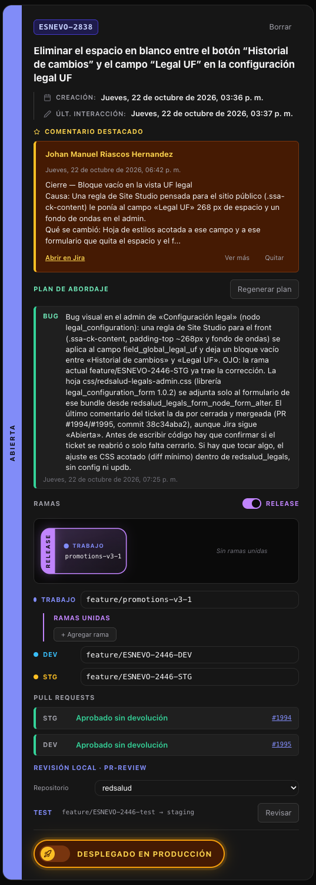

<sub><b>La card de un ticket</b></sub>

</td>
</tr>
</table>

<br/>

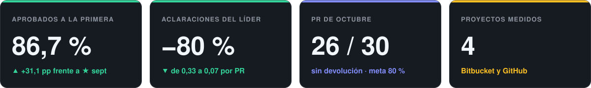

<br/>

### 🔎 Cómo leer las cifras

<table>
<tr>
<td width="33%" valign="top"><b>86,7 % · Aprobados sin retrabajo</b><br/><sub>De cada 100 PR que llegaron al líder, cuántos aprobó sin pedir cambios ni comentar.</sub></td>
<td width="33%" valign="top"><b>0,33 → 0,07 · Aclaraciones por PR</b><br/><sub>Dudas o correcciones del líder por PR: una cada 3 PR antes, una cada 15 ahora.</sub></td>
<td width="33%" valign="top"><b>−80 % · Reducción</b><br/><sub>Cuánto bajaron las aclaraciones del líder frente a septiembre.</sub></td>
</tr>
<tr>
<td valign="top"><b>pp · Puntos porcentuales</b><br/><sub>Diferencia directa entre porcentajes: de 55,6 % a 86,7 % son +31,1 pp.</sub></td>
<td valign="top"><b>★ Septiembre · Línea base</b><br/><sub>El mes de referencia, trabajado sin pr-review.</sub></td>
<td valign="top"><b>Devuelto</b><br/><sub>El revisor pidió cambios, comentó, hizo commits en la rama o lo rechazó.</sub></td>
</tr>
</table>

<br/>


# 📊 Informe

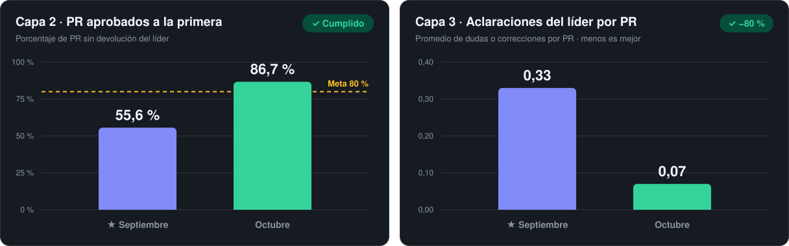

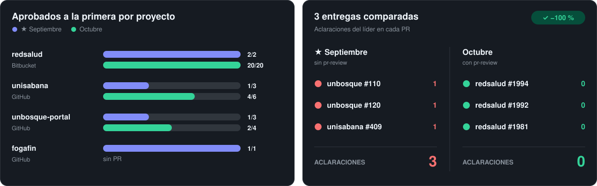

<details>
<summary><b>Objetivos completos y observaciones</b></summary>
<br/>

**Capa 2.** Lograr que al menos el 80 % de los pull requests de Git entre octubre y el 30 de noviembre de 2026, realizados con apoyo de IA, se aprueben sin retrabajo, comparándolo contra la línea base de septiembre registrada en Branch Manager.

**Capa 3.** Integrar en Branch Manager el código de pr-review de esinergia con un modelo de IA, para revisar el PR antes de que llegue al líder, y demostrar con 3 entregas comparadas una reducción de al menos 80 % en las aclaraciones.

**Capa 1.** Biblioteca de conocimiento de Site Studio en video, con calificación ≥ 4/5 de mínimo 6 desarrolladores. Se reporta aparte.

- **La prueba:** la aprobación a la primera del líder, registrada en Bitbucket y GitHub.
- **No cuentan:** los PR que el propio autor cerró sin revisión.
- **Devoluciones de octubre:** unbosque-portal #125 y #129 (comentarios) y unisabana #419 y #421 (ajustes del revisor).

</details>

<br/>


# 📘 Documentación

### 🔁 Flujo

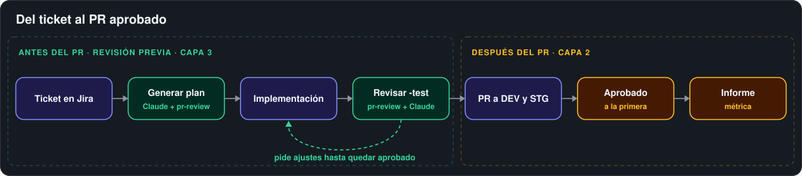

### 🧩 Anatomía de la card

<table>
<tr>
<td width="50%" align="center" valign="top">
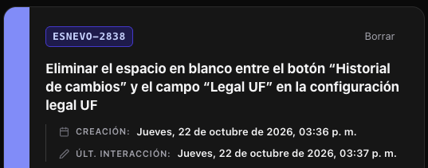<br/>
<b>1 · Encabezado</b><br/><sub>Clave, título, fechas y estado en Jira.</sub>
</td>
<td width="50%" align="center" valign="top">
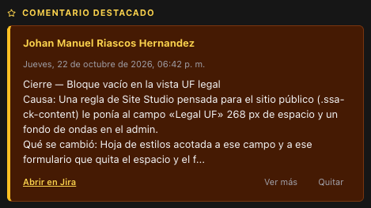<br/>
<b>2 · Comentario destacado</b><br/><sub>Un comentario de Jira fijado a la vista.</sub>
</td>
</tr>
<tr>
<td align="center" valign="top">
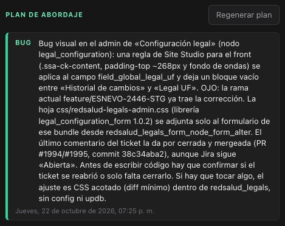<br/>
<b>3 · Plan de abordaje</b> <code>Capa 3</code><br/><sub>Claude lee el ticket y propone criterios, pasos, riesgos y pruebas. Se publica en Jira como nota interna.</sub>
</td>
<td align="center" valign="top">
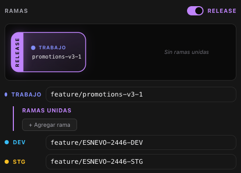<br/>
<b>4 · Ramas</b><br/><sub>Trabajo, DEV y STG; con «Release», las ramas unidas.</sub>
</td>
</tr>
<tr>
<td align="center" valign="top">
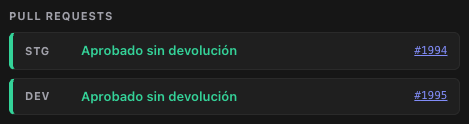<br/>
<b>5 · Pull requests</b> <code>Capa 2</code><br/><sub>Cada PR con «Aprobado sin devolución», «Devuelto» o «Abierto».</sub>
</td>
<td align="center" valign="top">
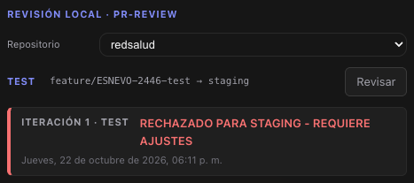<br/>
<b>6 · Revisión local</b> <code>Capa 3</code><br/><sub>«Revisar» simula el PR con pr-review + Claude y certifica.</sub>
</td>
</tr>
</table>

### 🤖 Agentes y servicios

<table>
<tr>
<td width="33%" valign="top"><b>🧠 Claude · Plan</b><br/><sub>Lee el ticket y el código y propone cómo abordarlo.</sub><br/><code>Generar plan</code> <code>Capa 3</code></td>
<td width="33%" valign="top"><b>🧪 Kit pr-review</b><br/><sub>Reúne la evidencia de la rama -test: diferencias, ramas y bloqueos.</sub><br/><code>Revisar</code> <code>Capa 3</code></td>
<td width="33%" valign="top"><b>🔍 Claude · Revisión</b><br/><sub>Aplica la política de pr-review en solo lectura y da el veredicto.</sub><br/><code>Revisar</code> <code>Capa 3</code></td>
</tr>
<tr>
<td valign="top"><b>🔏 Certificación</b><br/><sub>Firma el resultado con el commit exacto revisado.</sub><br/><code>Automática</code> <code>Capa 3</code></td>
<td valign="top"><b>🔀 Bitbucket y GitHub</b><br/><sub>Aprobaciones, cambios pedidos, comentarios y commits del revisor.</sub><br/><code>Sincronizar</code> <code>Capa 2</code></td>
<td valign="top"><b>📋 Jira</b><br/><sub>Tickets, comentarios y notas internas.</sub><br/><code>Buscador</code> <code>Plan</code></td>
</tr>
</table>

<details>
<summary><b>Qué pasa al pulsar «Revisar» y «Generar plan»</b></summary>

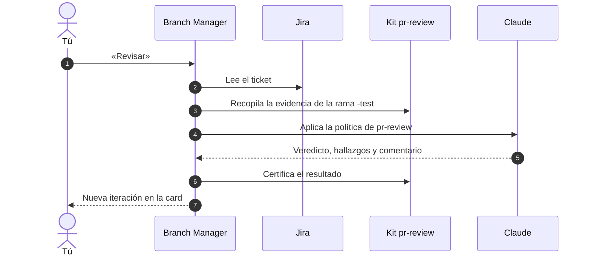

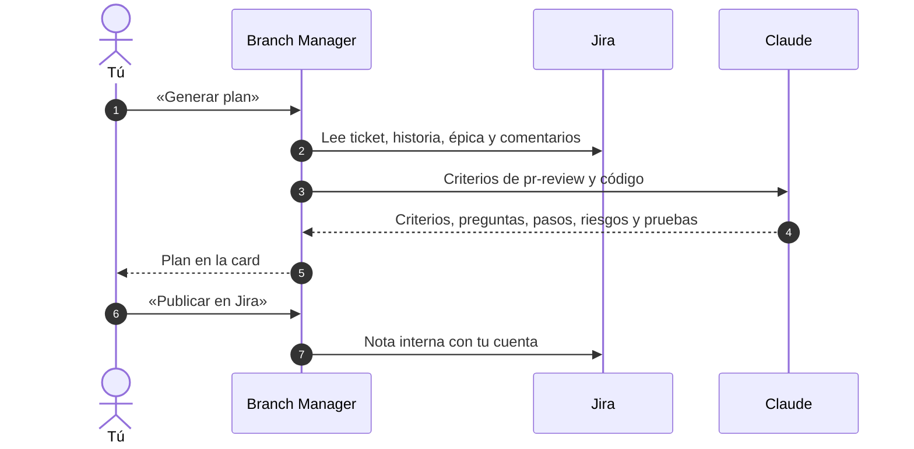

</details>

### 🖥️ Tablero e informe

<table>
<tr>
<td width="50%" align="center" valign="top">
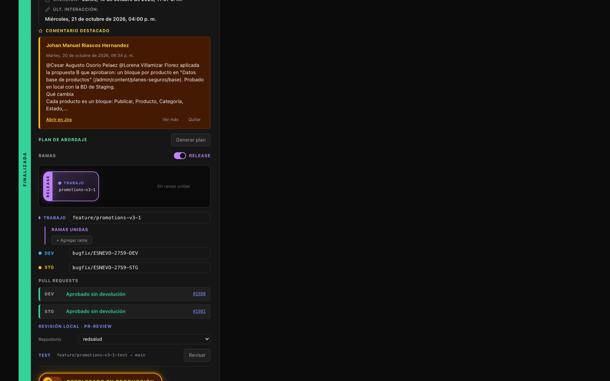<br/>
<b>Tablero</b><br/><sub>Buscador de Jira, cards, métrica del mes y tickets asignados.</sub>
</td>
<td width="50%" align="center" valign="top">
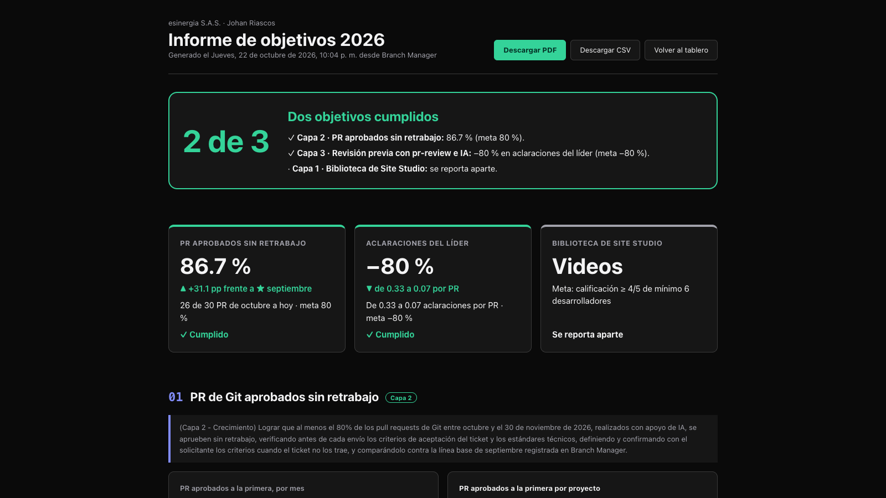<br/>
<b>Informe</b> · <code>/informe</code><br/><sub>Los 3 objetivos, meses comparados y descarga en PDF y CSV.</sub>
</td>
</tr>
</table>

### ⌨️ CLI para agentes de IA

| Comando | Qué hace | Objetivo |
|---|---|:-:|
| `bm plan CLAVE --wait` | Genera el plan de abordaje | `Capa 3` |
| `bm plan-publish CLAVE` | Publica el plan en Jira | `Capa 3` |
| `bm review CLAVE --wait` | Revisa la rama `-test` con pr-review | `Capa 3` |
| `bm prs CLAVE --sync` | PR del ticket y su resultado | `Capa 2` |
| `bm metrics --sync --detail` | Métrica con el detalle de cada PR | `Capa 2` |
| `bm card add CLAVE` | Crea la card de un ticket | — |

<br/>


# 🔧 Técnico

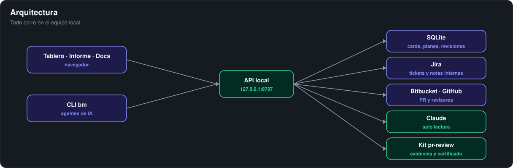

<table>
<tr>
<td width="50%" valign="top">

### 🚀 Instalación

```bash
cd branch-client
npm install
npm run dev
```

<sub>Tablero en <code>localhost:5173</code> · API en <code>127.0.0.1:8787</code></sub>

</td>
<td width="50%" valign="top">

### 🔑 Variables

<sub><code>.env</code> de la raíz (solo los nombres)</sub>

- **Jira** · `JIRA_BASE_URL` `JIRA_EMAIL` `JIRA_API_TOKEN`
- **Claude** · `BRANCH_CLAUDE_CONFIG_DIR`
- **Bitbucket** · `BITBUCKET_ENV_FILE`
- **Kit pr-review** · `PR_REVIEW_KIT_HOME`
- **GitHub** · sesión de `gh`

</td>
</tr>
<tr>
<td valign="top">

### 📁 Estructura

```
branch-client/
├── bin/bm.ts          CLI
├── server/            API local
│   ├── providers/     Bitbucket y GitHub
│   ├── review-runner  pr-review + Claude
│   └── plan-runner    Plan de abordaje
├── src/               React (atomic design)
└── public/docs/       Capturas
```

</td>
<td valign="top">

### 🔒 Seguridad

- 🏠 Todo corre **en local** (`127.0.0.1`).
- 👁️ La IA trabaja en **solo lectura**.
- 🔑 Las **credenciales** nunca llegan a la IA ni al navegador.
- 📝 Jira solo recibe **notas internas**, con confirmación.

</td>
</tr>
</table>


